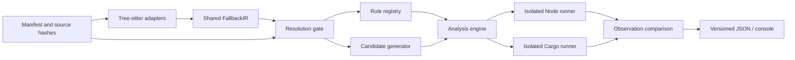

# Architecture and extension points

The default command takes two file paths and dumps their Tree-sitter syntax trees plus a unified diff. `syntax.py` uses a small `SyntaxContext` containing parsers; it does not construct the behavioral context, load a manifest, resolve types, or execute source files. The raw trees preserve named/anonymous nodes, fields, token text and source positions. Syntax diff rendering excludes positions so formatting outside tokens does not create changes.

The pipeline below describes the optional, original `compare` / `suite` behavioral commands. See [advanced usage](ADVANCED.md) for those commands; the two-file workflow is described in the [README](../README.md).

`Context` injects adapter, resolver, candidate, rule and runner services. `analyze()` aliases each used context service at entry and orchestrates work without constructing its dependencies. Tests replace services to verify that unresolved inputs cannot reach rules or execution. Pure parsing, wire encoding and report formatting helpers do not depend on the context.

- **Adapters** parse entire source files using real Tree-sitter grammars. They preserve byte-column source spans and source hashes and normalize the supported direct expression subset. They identify syntax, not method identity.
- **IR** describes language, function/parameter, parsed input type, fallback trigger (`falsy`, `nullish`, `none`, `filtered_falsy`), typed literal and source provenance. It is independent of Tree-sitter nodes.
- **Resolver protocol** is the trust gate. The shipped resolver validates explicit assumptions, supported primitive annotations, method identity assertions, input mapping, optional finite domains and matching fallback kinds. There is no compiler type/method resolver in this release. Future TypeScript compiler/rust-analyzer integrations can return evidence through the protocol.
- **Rules** receive IR plus resolution evidence. `OT-FALLBACK-001` evaluates the supported fallback policies on candidates to produce a static assessment. Static evaluation selects candidate warnings; only the real runner observations can confirm differences. A registry accepts additional rule implementations.
- **Candidates** are deterministic, bounded primitive samples or an explicit finite declared domain. Expected fixture labels do not influence analysis or execution.
- **Runners** copy original UTF-8 sources without expression rewriting. Node imports an `.mts` source using native type stripping. Cargo compiles a dependency-free project that calls the original Rust function via a module. Both harnesses emit one indexed JSON record per input. Missing values map explicitly to None; present values to Some. No Cargo build script or crate dependencies are copied from the input.
- **Comparison** requires both runner statuses to be successful, both languages to be present exactly once and complete, ordered, typed observation streams. Any protocol/runtime/compiler/resource failure is inconclusive. Numeric encoding is binary64, sign-aware for zero, with NaN normalized to one tag.
- **Reporters** implement a render protocol. The versioned report DTO contains provenance and evidence independently of console formatting. A future SARIF reporter can map rule IDs and spans to SARIF results; it is not implemented here. Consumers can already use JSON exit codes in CI. A packaged GitHub Action and migration-wide symbol alignment are future work.

This is a small supported semantic slice, not arbitrary-program equivalence checking. Candidate agreement does not establish equality on untested inputs. Side effects and eager/lazy default evaluation require future IR nodes and rules.
